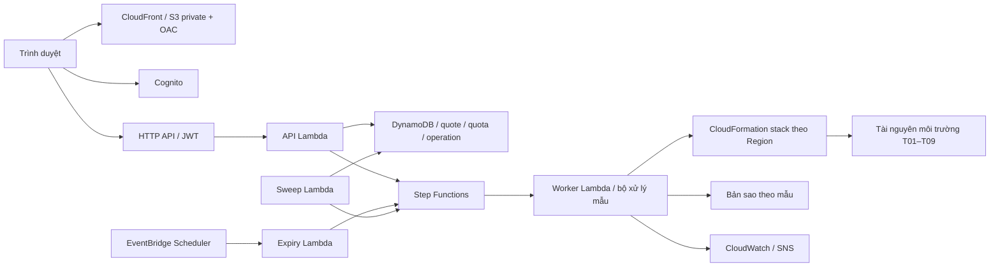

# Kiến trúc CloudHub

Luồng ghi dài được chấp nhận với operation ID rồi xử lý bất đồng bộ. Quote, quota, owner, khóa/version và idempotency phải được kiểm trước khi nhận lệnh. Tài nguyên môi trường dùng Region đã lưu; các dịch vụ toàn cầu được xử lý riêng. Country chỉ tin tuyến edge đã kiểm soát; không lấy header client tự khai làm quyền hoặc Region.

Sơ đồ mô tả thành phần có mã, không xác nhận một stack mới đã được triển khai. Hạ tầng quản lý và ứng dụng khách là các lớp khác nhau. Đổi tên miền hoặc DNS không tự migration Cognito/DynamoDB/dữ liệu môi trường.
